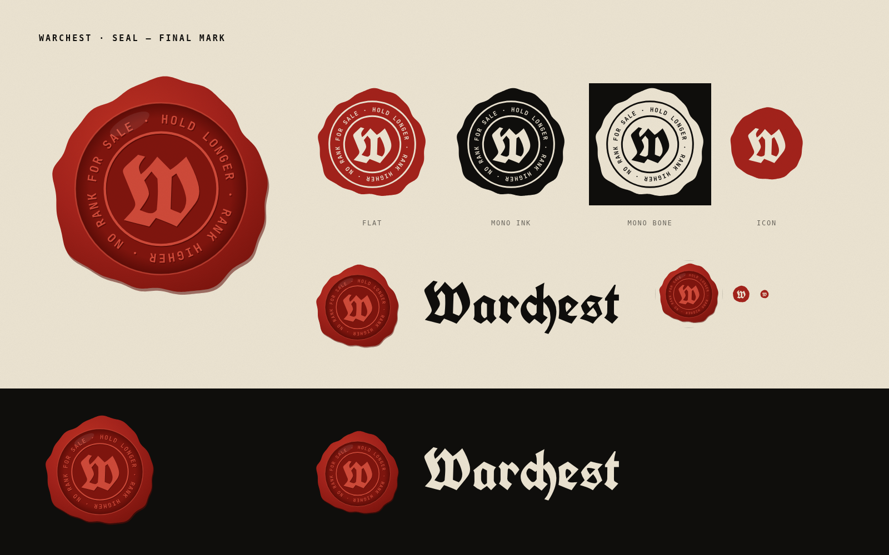
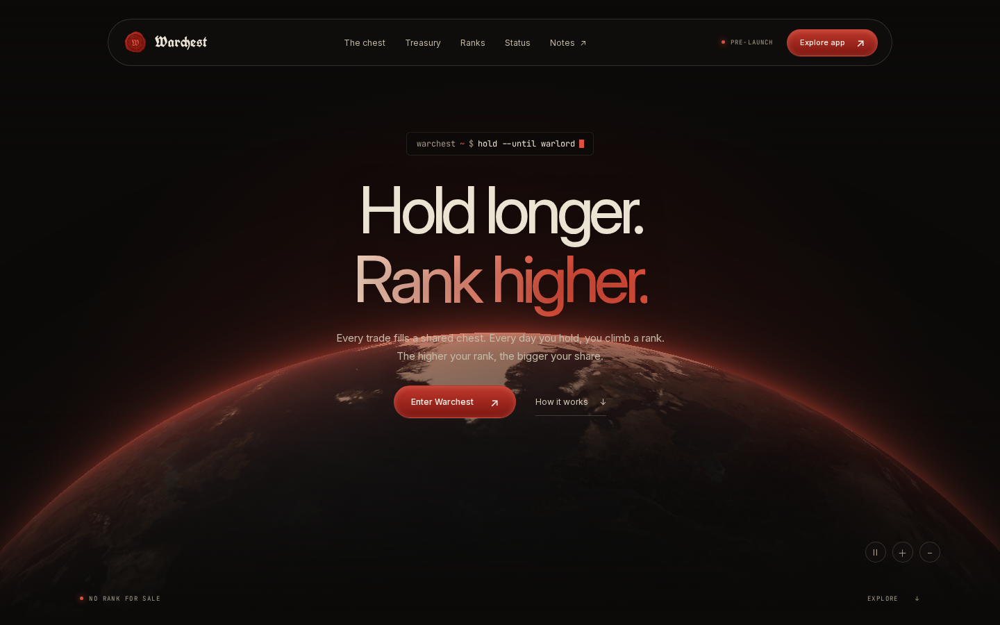

# Warchest brand kit

Everything needed to talk about Warchest in one folder: the seal, the wordmark, social images, colours, fonts, launch videos and screenshots of the site. Sources live next door (`../logos/seal/build.mjs`, `../videos/src/`); this folder holds the finished files.

## Logo — `logo/`

The mark is a wax seal: a gothic **W** ringed by *HOLD LONGER · RANK HIGHER · NO RANK FOR SALE*. All lettering is outlined, so the SVGs need no fonts.

| File | Use |
| --- | --- |
| `svg/seal.svg` | Main mark, full colour |
| `svg/seal-flat.svg` | Flat colour, for small sizes and print |
| `svg/seal-mono-ink.svg`, `svg/seal-mono-bone.svg` | One colour, on light / on dark |
| `svg/seal-icon.svg` | Favicon and app icon |
| `svg/wordmark-ink.svg`, `svg/wordmark-bone.svg` | "Warchest" in gothic, on light / on dark |
| `svg/lockup-ink.svg`, `svg/lockup-bone.svg` | Seal + wordmark |
| `png/seal-2048.png`, `png/seal-flat-1024.png`, `png/lockup-ink-2400.png` | Raster masters |
| `png/favicon-16.png`, `png/favicon-32.png`, `png/apple-touch-icon-180.png` | Browser icons |

Keep clear space of at least a quarter of the seal's width around it. Do not recolour, stretch, rotate past the built-in tilt, or set the wordmark in a live font.

## Social — `social/`

| File | Size | Use |
| --- | --- | --- |
| `avatar-1024.png`, `avatar-1024-dark.png`, `avatar-400.png` | square | X / Telegram / Discord profile |
| `x-banner-1500x500.png`, `x-banner-1500x500-dark.png` | 1500 × 500 | X header |
| `og-1200x630.png` | 1200 × 630 | Link preview |

## Colours

| Name | Hex | Role |
| --- | --- | --- |
| Night | `#0b0a09` | Website ground |
| Ink | `#0f0e0c` | Text on light, app ground |
| Bone | `#ece4d2` | Paper, text on dark |
| Wax | `#a3221b` | The seal, accents on light |
| Wax bright | `#e0503c` | Accents on dark |
| Wax deep | `#5c0c07` | Shadows, gradients |
| Muted | `#a59c8b` | Secondary text on dark |

Wax red is the only accent. Gold or green are not brand colours.

## Fonts — `fonts/`

All under the SIL Open Font License (licence files included).

| Font | Role |
| --- | --- |
| Inter | Website headings and body |
| JetBrains Mono | Labels, figures, terminal details |
| Anton | Video titles and app display |
| UnifrakturCook | Only inside the seal and wordmark — never for running text |

## Voice

- Tagline: **Hold longer. Rank higher.**
- Seal words: *No rank for sale.*
- Short lines: *Every trade fills the chest.* · *Ten ranks. No shortcuts.* · *The chest fights back.*
- Facts only: pre-launch, not deployed, audit pending. No promised returns, no fictional numbers.

## Videos — `videos/`

Every clip comes square (`.mp4`, 1080 × 1080) and vertical (`-9x16.mp4`, 1080 × 1920), 30 fps, silent.

| Folder | Clips | Use |
| --- | --- | --- |
| `hype/` | 05 manifesto, 06 rank rush, 07 siege cut, 08 sellers pay | Fast pre-launch hype |
| `countdown/` | t-7 … t-1 | One per day before launch |
| `terminal/` | 09 boot, 10 siege log, 11 rank up | Terminal-style teasers |

## Screens — `screens/`

The website (night edition with the seal): hero, treasury, ranks, closing band and mobile.

